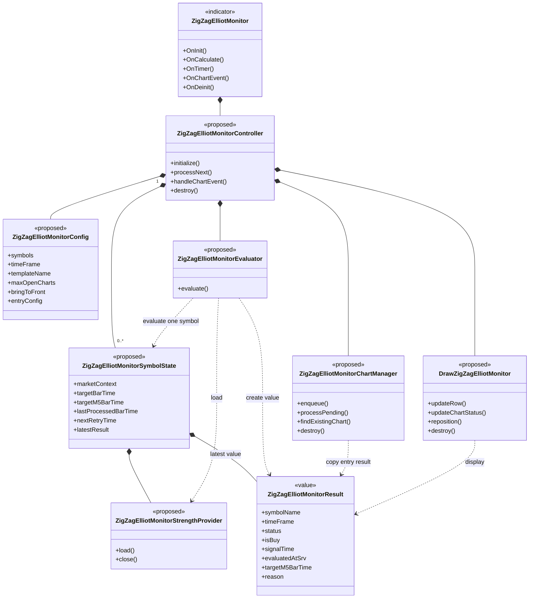
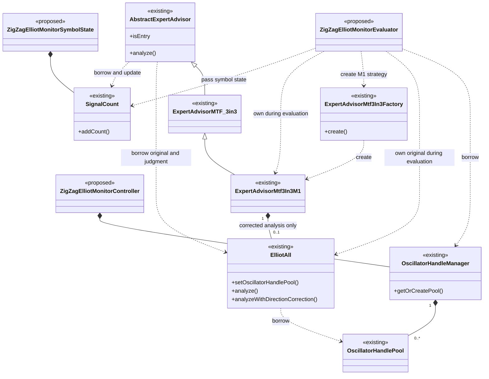
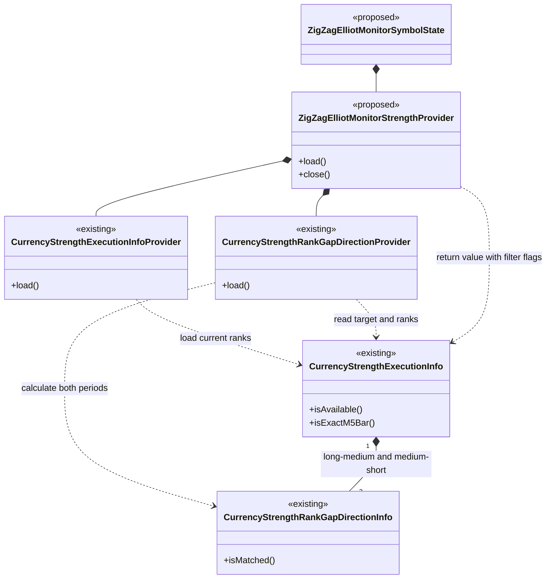

# ZigZagElliotMonitor クラス図（検討案）

- 作成日：2026/11/19（JST）
- 状態：設計検討時の案を保存。最小構成の実装とは一部異なる
- 参照コード：ZigZagElliot v2.80、コミット `6be7cef`

[複数通貨監視・チャート自動表示の検討案](ZigZagElliotMonitorProposal.md) を基にしたクラス構成です。クラス名・メソッド名・所有関係は実装前の案です。2026/11/19に実装した最小構成は [ZigZagElliotMonitor仕様](ZigZagElliotMonitor.md) を参照してください。初期版では通貨状態ごとに必要なオシレーターハンドルを所有し、ここにある設計案すべてを実装したものではありません。

図の `proposed` は新設案、`existing` は既存クラス、`value` は値として受け渡すデータを表します。`*--` は生成・解放を担当する所有関係、`..>` は利用・生成・参照の依存関係、`<|--` は継承です。メソッドの引数・戻り値と内部の補助クラスは省略しています。

## 1. 監視機能の全体構成

`ZigZagElliotMonitor` は `.mq5` のイベント入口を図示したもので、MQL5のクラスとして新設する意味ではありません。`OnCalculate` と `OnTimer` から同じ処理が重複しないよう、Controllerで実行状態を管理する案です。

| 新設案 | 責務 |
|---|---|
| `ZigZagElliotMonitorController` | 対象通貨の準備、処理順、分割実行、再試行、結果の振り分けを管理 |
| `ZigZagElliotMonitorConfig` | 対象通貨・時間足・テンプレート・表示上限などの設定と、既存の判定設定を保持 |
| `ZigZagElliotMonitorSymbolState` | 通貨ペアごとの対象時刻、待機状態、シグナル回数、通貨強弱の取得先、直近結果を保持 |
| `ZigZagElliotMonitorEvaluator` | 1通貨の分析を準備し、既存M1判定を呼び、結果を値へ変換 |
| `ZigZagElliotMonitorStrengthProvider` | 現在順位・両期間の増減を取得し、判定用の情報にまとめる。描画は担当しない |
| `ZigZagElliotMonitorChartManager` | 表示待ち、同じシグナルの重複防止、既存チャート検索、起動、テンプレート適用、表示上限を管理 |
| `DrawZigZagElliotMonitor` | 一覧の文字・色・配置と、変更した行の描画を担当 |
| `ZigZagElliotMonitorResult` | 通貨ペア、成立方向、対象時刻、結果・理由を値として受け渡す新設データ構造 |

Controllerは判定結果をStateへ保存し、成立時だけChartManagerへ渡します。チャート表示の状態はChartManagerから一覧へ別途反映し、「条件成立」と「チャート表示成功」を区別します。

## 2. 既存M1判定クラスの再利用

Factoryは継承元ではなく、判定クラスを生成する役割です。M1専用判定の使用と方向補正設定を明示して生成し、既存の波動・GMMA・通貨強弱などの成立条件を共用します。

| 対象 | 所有・寿命の案 |
|---|---|
| `OscillatorHandleManager` / Pool | Controllerが監視中保持し、通貨ごとのハンドルを再利用。EvaluatorとElliotAllは借用 |
| 元の `ElliotAll` | Evaluatorが1回の評価中だけ所有。通貨強弱情報と設定を渡して分析・判定する |
| Factoryで生成したM1判定 | Evaluatorが1回の評価中だけ所有。共通基底型のポインタで受け取る |
| 補正後の `ElliotAll` | 既存M1判定クラスが所有・解放。補正なしの場合は作成されない |
| `SignalCount` | SymbolStateが通貨ペア・時間足ごとに保持し、分析ごとに作り直さない |
| 表示用の結果 | `ZigZagElliotMonitorResult` へ値をコピーし、分析オブジェクト解放後も参照可能にする |

監視ではFactoryの `fromIsDrawArrow` をfalseにする案です。既存の `analyze()` は純粋な照会ではなく、シグナル回数を加算し、元分析の件名を更新し、判定インスタンスにCSV文字列などを保持します。チャート起動の再試行のために成立判定を繰り返さず、成立済み結果をChartManagerへ保持します。

結果をコピーしてから判定インスタンス、元分析の順に解放し、Poolは分析オブジェクトより長く保持します。補正分析や最新波動のポインタを、表示待ちキューや一覧に残しません。

## 3. 通貨強弱の取得と判定用データ

現在順位と増減履歴は、同じ対象M5時刻で取得します。両期間を取得する既存の `load()` を使い、長中期・中短期で履歴取得を重複させない構成です。

`CurrencyStrengthExecutionInfoProvider` の検索キャッシュは直近1件、`CurrencyStrengthRankGapDirectionProvider` の対象通貨は生成時に固定されるため、まず通貨ペア別に保持する案とします。接続数とメモリ使用量は実測し、複数通貨でさらに共有する設計はその後に判断します。

取得結果は値コピーした上で、M1の通貨強弱ON・増減「両方」などの判定フラグを設定します。銘柄名の接頭辞・接尾辞から通貨を推測せず、実際のシンボルの通貨属性を使用します。

## 4. 既存Controllerを直接流用しない範囲

| 既存クラス | 図での扱い |
|---|---|
| `ZigZagElliotListController` / `ElliotAllList` | 複数通貨の準備方法を参考にする。全通貨の一括分析をそのまま監視の分割処理として呼ばない |
| `Mtf3In3AlertController` | 描画・DB保存・CSV出力などを含むため、全体を流用せず下位の判定クラスを共用する案 |
| `CurrencyStrengthPairRankController` | 順位パネルの描画・再描画・削除を含むため、取得層は下位Providerを共用する案 |
| `ZigZagElliotConfig` | MonitorConfigの `entryConfig` に既存の判定・取得設定を保持する案。通常版M1の初期設定は明示的に設定する |

通常版M1のエントリー条件を変える設計ではありません。監視向けの分割実行・時刻管理・結果保存を追加し、条件式の二重管理を避けることを目的とします。

## 5. 実装時に詰める境界

- Controllerが各通貨の評価対象時刻を固定し、Evaluatorが分析前後の足交代と対象M5時刻を確認する。データ待機を確定した不成立と区別する。
- 判定結果とチャート表示の状態を分離する。ChartManagerは表示結果や失敗状態を管理し、画面表示の失敗でSignalCountを巻き戻したり加算し直したりしない。
- シグナル識別は実銘柄・時間足・元M1の基準時刻・売買方向を基本案とする。設定変更・再起動をまたぐ識別方法と保存先は未決定。
- ChartManagerの重複記録・表示待ちキューの具体的なデータ構造、永続化、複数設置間の排他は未決定であり、図では内部構造を省略する。
- 表示上限、同時成立の優先順、起動直後の成立、前面表示、監視終了時のチャートの扱いは、検討案に記載した未決定事項のままとする。
- 既存判定の共用だけでは対象時刻の一致まで保証できないため、同じ時刻・設定・データを使った通常版との比較を実装後に行う。

この文書はクラス図の作成のみです。MQL5コード、チャート起動処理、テンプレートは作成・変更していません。
